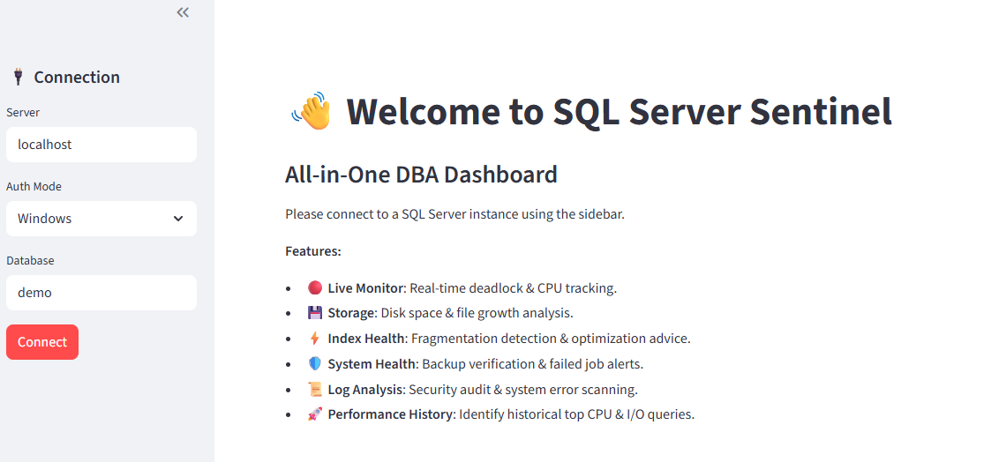

# SQL Server Sentinel 🛡️

<p align="left">
  
  
  
  
</p>

## Project Overview

**SQL Server Sentinel** is a modular, high-performance database administration dashboard. It provides DBAs and Data Engineers with real-time visibility into SQL Server health, storage, and performance.

By leveraging Python and direct **Dynamic Management View (DMV)** queries, this tool provides an actionable "DBA Cockpit" that replaces traditional, slow monitoring methods like `sp_who2` or SSMS Activity Monitor.

> **Why I built this:** In high-concurrency environments, blocking sessions can silently halt production pipelines. I created this tool to reduce the **Mean Time to Resolution (MTTR)** for database locks from minutes to seconds.

---

## 🌟 Key Features

* **🔴 Live Monitor**: Real-time detection of blocking chains with dynamically generated `KILL` scripts to resolve deadlocks instantly.
* **💾 Storage Space**: Integrated monitoring of OS-level drive capacity and DB-level `MDF`/`LDF` file growth.
* **⚡ Index Health**: Advanced fragmentation analysis (>30%) with maintenance advice: `REBUILD` vs. `REORGANIZE`.
* **🛡️ System Health**: Automated audits for missing backups (24h) and failed SQL Agent job failures.
* **📜 Log Analysis**: Security-focused auditing of Error Logs to identify brute-force login attacks and critical system errors.
* **🚀 Performance History**: Historical analysis of the **Plan Cache** to identify top CPU and I/O consuming queries.

---

## 🏗️ Tech Stack & Architecture

This project follows a strict **MVC (Model-View-Controller)** pattern to ensure high maintainability:

* **Frontend**: [Streamlit](https://streamlit.io/) for responsive navigation and real-time visualization.
* **Backend**: Specialized query modules for direct database interaction.
* **Connector**: `pyodbc` with a custom **Driver Auto-Discovery** algorithm.
* **Analytics**: `pandas` for result set manipulation and `plotly` for capacity charting.

---

## 📸 Demo Screenshots

### 🏠 All-in-One Dashboard
The main interface features a secure connection portal and a comprehensive overview of all sentinel modules.


---

## 🚀 Quick Start

### Prerequisites
* Python 3.9+
* SQL Server with `VIEW SERVER STATE` permissions.

### Installation & Launch

1. **Clone the repository**
   ```bash
   git clone [https://github.com/Bridge4906273/sql-server-sentinel.git](https://github.com/Bridge4906273/sql-server-sentinel.git)
   cd sql-server-sentinel
Install dependencies

Bash

pip install streamlit pandas pyodbc plotly
Run the application

Bash

streamlit run main.py
## 📂 File Structure

```text
sql-server-sentinel/
├── main.py                 # App routing & Session State
├── db_manager.py           # Connection & Driver Detection
├── requirements.txt        # Project dependencies
├── backend/                # Logic Layer: SQL Query Modules
│   ├── queries_monitor.py  # Live session & blocking logic
│   ├── queries_storage.py  # Disk & file growth logic
│   ├── queries_index.py    # Index fragmentation logic
│   ├── queries_health.py   # Backup & Job audit logic
│   ├── queries_logs.py     # Error log auditing logic
│   └── queries_perf.py     # Plan cache & performance logic
└── views/                  # UI Layer: Streamlit Views
    ├── view_monitor.py     # Live Monitor UI
    ├── view_storage.py     # Storage Overview UI
    ├── view_index.py       # Index Hygiene UI
    ├── view_health.py      # System Health UI
    ├── view_logs.py        # Log Analysis UI
    └── view_perf.py        # Performance History UI
